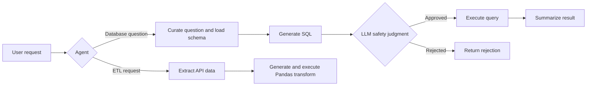

# Ola AI Data Agent

An experimental, agent-based data assistant for working with ride-hailing data. It uses LangGraph workflows and language models to answer natural-language questions with PostgreSQL and to perform API-based extract/transform/load (ETL) tasks.

## Features

- **SQL analyst** — curates a natural-language question, retrieves PostgreSQL schema context, generates a query, asks an LLM-based judge whether it appears read-only, then executes it and summarizes the result.
- **ETL analyst** — fetches JSON from an API and saves it as CSV, JSON Lines, or Parquet; it can also generate and run Pandas transformations on supported input files.
- **Ride-hailing schema** — `feeddb.py` defines tables for users, vehicles, rides, payments, and ratings.

## Workflow overview



## Requirements

- Python 3.14 or newer
- [uv](https://docs.astral.sh/uv/)
- An OpenAI API key for the configured models
- PostgreSQL, if using the SQL analyst or database loader
- Local CSV files under `data/` if loading the sample ride-hailing dataset (these files are not included in the repository)

## Setup

1. Install `uv` if it is not already installed.
2. From the repository root, install the project dependencies:

   ```sh
   uv sync
   ```

3. Create a `.env` file in the repository root. Add your OpenAI key, and the PostgreSQL settings if you plan to use database features:

   ```dotenv
   OPENAI_API_KEY=your_openai_api_key

   host=localhost
   port=5432
   user=your_postgres_user
   password=your_postgres_password
   database=your_database_name
   ```

   Keep `.env` private; it is excluded from version control. The SQL agent reads the lowercase PostgreSQL variable names shown above. `ANTHROPIC_API_KEY` is only needed if you change the LLM selection to use Anthropic.

## Using the agents

The agents are Python modules rather than a command-line application. Invoke them from Python code at the repository root.

### SQL analyst

The SQL graph expects the fields below. It reads database credentials from `.env`, inspects the `public` schema, and then processes the question.

```python
from agents.sql_analyst import sql_analyst

result = sql_analyst.invoke(
	{
		"messages": [],
		"user_question": "How many rides are in each status?",
		"curated_ques": "",
		"prompt_query_context": "",
		"generated_sql_query": "",
		"is_safe": "No",
		"comments": "",
		"sql_query_execution_result": "",
		"final_answer": "",
	}
)

print(result["final_answer"])
```

### ETL analyst

The ETL graph accepts a chat message. For example, to extract a JSON API response into the project’s `data/extract` folder:

```python
from langchain_core.messages import HumanMessage
from agents.etl_analyst import etl_analyst

result = etl_analyst.invoke(
	{
		"messages": [
			HumanMessage(
				content=(
					"Extract https://pokeapi.co/api/v2/pokemon and save it "
					"to data/extract in CSV format."
				)
			)
		]
	}
)

print(result["messages"][-1].content)
```

The extractor expects an API response with a `results` field. Supported output formats are CSV, JSON Lines (`json`), and Parquet. The transformation tool reads CSV, JSON Lines, or Parquet input.

## Database and local data

`feeddb.py` creates the PostgreSQL tables and imports the CSV files `users.csv`, `vehicles.csv`, `rides.csv`, `payments.csv`, and `ratings.csv` from `data/`. Configure `.env` first and provide those files locally before using the loader.

> **Warning:** `feeddb.py` runs a `TRUNCATE` on all five tables before loading the CSVs. Do not run it against a database containing data you need to keep.

The `data/` directory is ignored by Git, so its contents must be supplied separately. Do not add real personal or payment data to a public repository.

## Security notes

- The SQL safety check is an LLM judgment, **not** a security boundary. Use a dedicated PostgreSQL account restricted to read-only access and limit its permissions to the required schema.
- The ETL transformation tool executes model-generated Python with `exec`. Only use it with trusted requests and data, and run it in an appropriately isolated environment. Do not expose it to untrusted users or sensitive files.
- Review generated SQL and transformation code before using this experimental project with production systems or data.

## Project layout

```text
agents/       LangGraph SQL and ETL agents
Models/       Pydantic state schemas
utils/        Database access, ETL helpers, and LLM selection
data/         Local input/output data (ignored by Git)
feeddb.py     PostgreSQL schema creation and CSV loader
```
